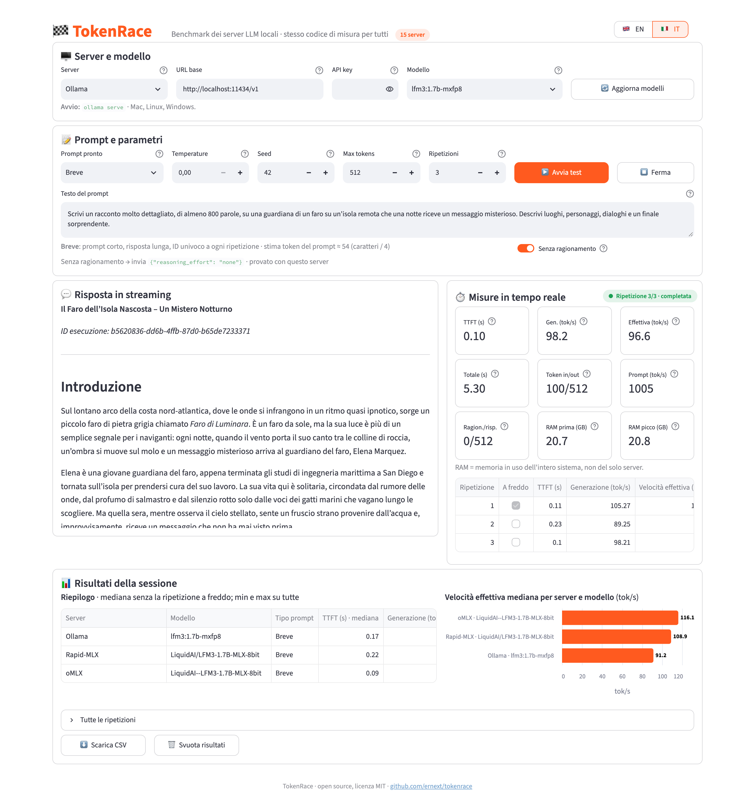

# 🏁 TokenRace — Local LLM Speed Test

[](https://www.python.org)
[](https://streamlit.io)
[](LICENSE)
[](#server-supportati)
[](#lingue)

[English](README.md) · **Italiano**

Un **LLM inference speed test**: confronta gli inference server locali (Ollama, LM Studio, Rapid-MLX, oMLX, llama.cpp, vLLM e altri) sul tuo hardware, con **lo stesso identico codice di misura** per tutti.

La velocità dipende dalla combinazione di modello, inference server e hardware: non c'è un vincitore universale, e i numeri misurati altrove, con altre regole, raramente valgono per la tua macchina. **Prima misuri, poi scegli.**

Una piccola app [Streamlit](https://streamlit.io): scegli server e modello, avvii il test e vedi in tempo reale TTFT, token al secondo, tempo totale e RAM, con riepilogo, grafico ed export CSV.

<p align="center">
  
</p>
<p align="center"><sub>LFM3 1.7B a 8 bit su Rapid-MLX e oMLX (stessi pesi MLX) e su Ollama (mxfp8), prompt "Breve", senza ragionamento, 3 ripetizioni su un Mac. Un singolo esempio, non una classifica.</sub></p>

## Caratteristiche

- Stesso metodo per tutti i server: `POST /chat/completions` in streaming, cronometrato lato client con `time.perf_counter()`, mai con le statistiche dei server.
- Tre prove pronte: **Breve** (risposta lunga), **Lungo** (≈8.000 token di contesto) e **Cache** (prompt identico a ogni ripetizione).
- Risposta in streaming e misure in tempo reale.
- Modelli con ragionamento cronometrati correttamente, con token di ragionamento e di risposta separati, e interruttore **Senza ragionamento**.
- Prima ripetizione segnata "a freddo" ed esclusa dalla mediana.
- Riepilogo con mediana, minimo e massimo, grafico per server e modello ed export CSV.
- Interfaccia in inglese e italiano; server, valori predefiniti e testi in file TOML facili da modificare.
- Tutto locale: niente database, account o telemetria.

## Risultati di esempio

LFM3 1.7B a 8 bit su Apple M5 Pro (24 GB), prompt "Breve", 512 token, mediana di 3 ripetizioni a caldo. Velocità effettiva in tok/s.

| Server | IT, ragionamento attivo | IT, senza ragionamento | EN, ragionamento attivo | EN, senza ragionamento |
|---|---:|---:|---:|---:|
| oMLX | **131,8** | **129,1** | 123,1 | **117,2** |
| Rapid-MLX | 128,8 | 126,8 | **127,0** | 103,2 |
| Ollama (mxfp8) | 118,0 | 113,9 | 101,1 | 104,4 |

- oMLX e Rapid-MLX usano gli stessi pesi MLX (`LiquidAI/LFM3-1.7B-MLX-8bit`).
- Con il ragionamento attivo oMLX e Ollama passano tutti i 512 token a ragionare, mentre Rapid-MLX con questo modello non ragiona: quelle colonne non sono un confronto alla pari.
- Lo stesso test può variare del 10–20% da un minuto all'altro sullo stesso Mac: considera pari le differenze piccole e fai le tue prove.

## Requisiti

- Python 3.11 o superiore
- Almeno un server LLM locale compatibile OpenAI, già avviato

Pensata per Mac con Apple Silicon, funziona anche su Linux e Windows.

## Installazione

```bash
git clone https://github.com/ernext/tokenrace.git
cd tokenrace
python3 -m venv .venv
source .venv/bin/activate        # Windows: .venv\Scripts\activate
pip install -r requirements.txt
```

## Avvio

```bash
streamlit run app.py
```

Poi apri http://localhost:8501. L'interfaccia si apre in inglese: cambia lingua con il selettore in alto a destra, oppure apri direttamente http://localhost:8501/?lang=it.

## Server supportati

TokenRace non installa né avvia i server: vanno avviati a parte. Tutti parlano la stessa API compatibile OpenAI, e l'app mostra il comando di avvio del server scelto.

Se il tuo server non è in elenco ma è compatibile OpenAI, scegline uno qualsiasi e cambia l'URL base, oppure aggiungilo in `config/servers.toml` (vedi sotto).

| Server | URL predefinito | Avvio | Note |
|---|---|---|---|
| &nbsp;[Ollama](https://ollama.com) | `http://localhost:11434/v1` | `ollama serve` | Mac, Linux, Windows. |
| &nbsp;[LM Studio](https://lmstudio.ai) | `http://localhost:1234/v1` | `lms server start && lms load <model>` | Mac, Linux, Windows. |
| &nbsp;[Rapid-MLX](https://github.com/raullenchai/Rapid-MLX) | `http://localhost:7659/v1` | `rapid-mlx serve <model> --port 8000` | Solo Mac. L'app Rapid-MLX Desktop usa la porta 7659 e richiede la API key; la CLI usa la 8000. |
| &nbsp;[oMLX](https://github.com/jundot/omlx) | `http://localhost:8000/v1` | — | Solo Mac. Avvialo dall'app oMLX: usa la porta 8000 e richiede la API key impostata nell'app. |
| &nbsp;[mlx_lm.server](https://github.com/ml-explore/mlx-lm) | `http://localhost:8080/v1` | `mlx_lm.server --model <model> --port 8080` | Solo Mac. Server di riferimento MLX, senza ottimizzazioni extra. |
| &nbsp;[llama.cpp (llama-server)](https://github.com/ggml-org/llama.cpp) | `http://localhost:8080/v1` | `llama-server -m <file.gguf> --port 8080` | Mac, Linux, Windows. Il motore usato da Ollama e LM Studio. |
| &nbsp;[vLLM](https://github.com/vllm-project/vllm) | `http://localhost:8000/v1` | `vllm serve <model>` | Linux con GPU NVIDIA/AMD. Il più usato in produzione. |
| &nbsp;[SGLang](https://github.com/sgl-project/sglang) | `http://localhost:30000/v1` | `python -m sglang.launch_server --model-path <model>` | Linux con GPU NVIDIA/AMD. |
| &nbsp;[Lemonade](https://github.com/lemonade-sdk/lemonade) | `http://localhost:13305/api/v1` | `lemonade-server serve` | Windows/Linux, ottimizzato per AMD Ryzen AI. Le versioni vecchie usano la porta 8000. |
| &nbsp;[Docker Model Runner](https://docs.docker.com/ai/model-runner/) | `http://localhost:12434/engines/v1` | `docker desktop enable model-runner --tcp 12434` | Mac, Linux, Windows. Serve l'accesso TCP dall'host attivo. |
| &nbsp;[Unsloth Studio](https://github.com/unslothai/unsloth) | `http://localhost:8888/v1` | `unsloth run --model <model>` | Porta 8888 presa dagli esempi: quella vera la stampa «unsloth run» all'avvio. Serve la API key sk-unsloth-… (Studio → Impostazioni → API). |
| &nbsp;[LocalAI](https://github.com/mudler/LocalAI) | `http://localhost:8080/v1` | `local-ai run <model>` | Mac, Linux, Windows. |
| &nbsp;[Jan](https://github.com/janhq/jan) | `http://localhost:1337/v1` | — | Mac, Linux, Windows. In Jan: Impostazioni → Local API Server → Avvia. Richiede la API key impostata in Jan. |
| &nbsp;[KoboldCpp](https://github.com/LostRuins/koboldcpp) | `http://localhost:5001/v1` | `koboldcpp --model <file.gguf>` | Mac, Linux, Windows. |
| &nbsp;[text-generation-webui](https://github.com/oobabooga/textgen) | `http://localhost:5000/v1` | — | Mac, Linux, Windows. Avvialo con --api. Su Mac la porta 5000 è occupata dal Ricevitore AirPlay: usa --api-port 5005 e cambia l'URL. |

Note:
- Diversi server condividono la porta 8000 o 8080: avviane uno alla volta, oppure cambia porta con `--port` e aggiorna l'URL nell'app.
- Il campo **API key** è facoltativo: serve per Rapid-MLX Desktop, oMLX, Jan, Unsloth Studio o vLLM avviato con `--api-key`. Non viene mai salvato né esportato.

## Misure

- **TTFT**: tempo dall'invio della richiesta al primo chunk non vuoto (contenuto o ragionamento).
- **Generazione (tok/s)**: (token output − 1) / (ultimo token − primo token).
- **Velocità effettiva (tok/s)**: token output / (ultimo token − invio richiesta).
- **Elaborazione prompt (stima)**: token input / TTFT.
- **RAM**: memoria in uso dell'intero sistema, campionata ogni 0,5 s (valore prima del test e picco).

I token arrivano dal campo `usage`. Se il server non lo fornisce, vengono contati i chunk e compare l'avviso "conteggio stimato".

## Prompt pronti

- **Breve**: prompt corto, risposta lunga.
- **Lungo**: circa 8.000 token di contesto, risposta breve.
- **Cache**: lo stesso prompt lungo, identico a ogni ripetizione.

In Breve e Lungo ogni ripetizione inizia con un ID univoco, così la cache del prompt non altera il risultato. I prompt esistono in entrambe le lingue: confronta solo prove fatte con la stessa lingua del prompt (il CSV la registra).

L'interruttore **Senza ragionamento** invia un parametro diverso a seconda del server (✅ = provato):
- Ollama: `reasoning_effort: "none"` ✅
- LM Studio: `reasoning_effort: "none"` più `chat_template_kwargs` ✅
- oMLX: `chat_template_kwargs: {"enable_thinking": false}` ✅
- text-generation-webui: `enable_thinking: false`
- tutti gli altri (llama.cpp, MLX, vLLM, SGLang…): `chat_template_kwargs: {"enable_thinking": false}`

Alcuni modelli ragionano comunque: in quel caso l'app mostra un avviso.

## Struttura del progetto

```
app.py               interfaccia Streamlit
tokenrace/
  bench.py           logica di misura (streaming, cronometro, RAM, token), senza Streamlit
  config.py          lettura dei file TOML
  i18n.py            traduzioni
config/
  servers.toml       server preconfigurati
  defaults.toml      parametri predefiniti, timeout, lingue, colori
  prompts.toml       testi dei prompt pronti, per lingua
locales/
  en.toml, it.toml   testi dell'interfaccia
assets/style.css     stile grafico
```

**Aggiungere un server**: un blocco `[[server]]` in `config/servers.toml` e la sua nota sotto `[server_notes]` in ogni file `locales/*.toml`.

<a id="lingue"></a>**Aggiungere una lingua**: copia `locales/en.toml` come `locales/<codice>.toml`, traducilo, aggiungi i testi dei prompt in `config/prompts.toml` e il codice in `languages` dentro `config/defaults.toml`.

## Limiti

- La RAM è quella dell'intero sistema, non del solo server.
- Misura la velocità, non la qualità delle risposte.
- La velocità di elaborazione del prompt è una stima (token input / TTFT) e include la latenza di rete e l'eventuale caricamento del modello.
- Le porte predefinite di Unsloth Studio e text-generation-webui vengono da esempi nella documentazione: verificale all'avvio del server.

## Contribuire

Segnalazioni e pull request sono benvenute, in particolare:
- conferme o correzioni su porte e parametri "senza ragionamento" dei server non ancora provati;
- nuovi server compatibili OpenAI;
- nuove traduzioni.

Se TokenRace ti è utile, una ⭐ su GitHub fa sempre piacere.

## Licenza

[MIT](LICENSE). I loghi dei server appartengono ai rispettivi progetti e sono usati solo per identificarli.
