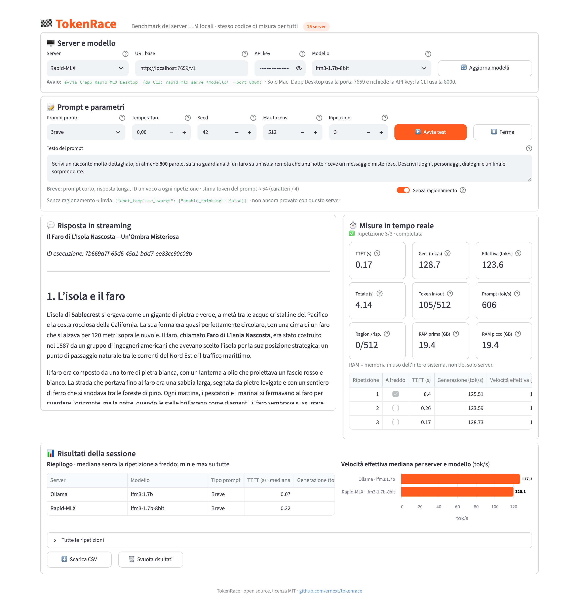

# 🏁 TokenRace — Local LLM Speed Test

[](https://www.python.org)
[](https://streamlit.io)
[](LICENSE)
[](#server-supportati)

Confronta la velocità dei server LLM locali (Ollama, LM Studio, Rapid-MLX, oMLX, llama.cpp, vLLM e altri) con **lo stesso identico codice di misura** per tutti.

Un'app [Streamlit](https://streamlit.io) in un solo file: scegli server e modello, avvii il test e vedi in tempo reale TTFT, token al secondo, tempo totale e RAM, con riepilogo, grafico ed export CSV.

<p align="center">
  
</p>
<p align="center"><sub>LFM3 1.7B su Ollama (4 bit, nvfp4) e su Rapid-MLX Desktop (8 bit), prompt "Breve", senza ragionamento, 3 ripetizioni. Quantizzazioni diverse: è un esempio, non una classifica.</sub></p>

> *English:* TokenRace is a single-file Streamlit app that benchmarks local OpenAI-compatible LLM servers (Ollama, LM Studio, MLX servers, llama.cpp, vLLM…) with identical client-side timing. The UI is in Italian.

## Caratteristiche

- Stesso metodo per tutti i server: `POST /chat/completions` in streaming, cronometrato lato client con `time.perf_counter()`, mai con le statistiche dei server.
- Tre prove pronte: **Breve** (risposta lunga), **Lungo** (≈8.000 token di contesto) e **Cache** (prompt identico a ogni ripetizione).
- Risposta in streaming e misure in tempo reale.
- Modelli con ragionamento cronometrati correttamente, con token di ragionamento e di risposta separati, e opzione **Senza ragionamento**.
- Prima ripetizione segnata "a freddo" ed esclusa dalla mediana.
- Riepilogo con mediana, minimo e massimo, grafico per server e modello ed export CSV.
- Tutto locale: niente database, account o telemetria.

## Requisiti

- Python 3.11 o superiore
- Almeno un server LLM locale compatibile OpenAI, già avviato

Pensata per Mac con Apple Silicon, ma funziona anche su Linux e Windows.

## Installazione

```bash
git clone https://github.com/ernext/tokenrace.git
cd tokenrace
python3 -m venv .venv
source .venv/bin/activate        # Windows: .venv\Scripts\activate
pip install -r requirements.txt
```

## Avvio

```bash
streamlit run app.py
```

Poi apri http://localhost:8501.

## Server supportati

TokenRace non installa né avvia i server: vanno avviati a parte. Tutti parlano la stessa API compatibile OpenAI; nell'app, sotto il selettore, compare il comando di avvio del server scelto.

Se il tuo server non è in elenco ma è compatibile OpenAI, sceglierne uno qualsiasi e cambiare l'URL base funziona lo stesso.

| Server | Comando | URL predefinito | Piattaforma |
|---|---|---|---|
| Ollama | `ollama serve` | http://localhost:11434/v1 | Mac, Linux, Windows |
| LM Studio | `lms server start`, poi `lms load <modello>` | http://localhost:1234/v1 | Mac, Linux, Windows |
| Rapid-MLX | app Rapid-MLX Desktop (oppure `rapid-mlx serve <modello> --port 8000`) | http://localhost:7659/v1 (Desktop, con API key) · 8000 (CLI) | Mac |
| oMLX | dall'app oMLX o dalla sua CLI | http://localhost:8000/v1 | Mac |
| mlx_lm.server | `mlx_lm.server --model <modello> --port 8080` | http://localhost:8080/v1 | Mac |
| llama.cpp | `llama-server -m <file.gguf> --port 8080` | http://localhost:8080/v1 | Mac, Linux, Windows |
| vLLM | `vllm serve <modello>` | http://localhost:8000/v1 | Linux (GPU) |
| SGLang | `python -m sglang.launch_server --model-path <modello>` | http://localhost:30000/v1 | Linux (GPU) |
| Lemonade | `lemonade-server serve` | http://localhost:13305/api/v1 | Windows, Linux (AMD) |
| Docker Model Runner | `docker desktop enable model-runner --tcp 12434` | http://localhost:12434/engines/v1 | Mac, Linux, Windows |
| Unsloth Studio | `unsloth run --model <modello>` | http://localhost:8888/v1 (da verificare) | vedi documentazione Unsloth |
| LocalAI | `local-ai run <modello>` | http://localhost:8080/v1 | Mac, Linux, Windows |
| Jan | Impostazioni → Local API Server → Avvia | http://localhost:1337/v1 | Mac, Linux, Windows |
| KoboldCpp | `koboldcpp --model <file.gguf>` | http://localhost:5001/v1 | Mac, Linux, Windows |
| text-generation-webui | avvio con `--api` | http://localhost:5000/v1 | Mac, Linux, Windows |

Note:
- Diversi server condividono la porta 8000 o 8080: avviane uno alla volta, oppure cambia porta con `--port` e aggiorna l'URL nell'app.
- Unsloth Studio stampa porta e API key all'avvio: se la porta non è 8888, cambia l'URL nell'app.
- Su Mac la porta 5000 è occupata dal Ricevitore AirPlay: avvia text-generation-webui con `--api-port 5005`.
- Il campo **API key** è facoltativo: serve per Jan, Unsloth Studio (chiave `sk-unsloth-…` da Impostazioni → API) o per vLLM avviato con `--api-key`.

## Misure

- **TTFT**: tempo dall'invio della richiesta al primo chunk non vuoto (contenuto o ragionamento).
- **Generazione (tok/s)**: (token output − 1) / (ultimo token − primo token).
- **Velocità effettiva (tok/s)**: token output / (ultimo token − invio richiesta).
- **Elaborazione prompt (stima)**: token input / TTFT.
- **RAM**: memoria in uso dell'intero sistema, campionata ogni 0,5 s (valore prima del test e picco).

I token arrivano dal campo `usage`. Se il server non lo fornisce, vengono contati i chunk e compare l'avviso "conteggio stimato".

La prima ripetizione è segnata "a freddo" e non entra nella mediana.

## Prompt pronti

- **Breve**: prompt corto, risposta lunga.
- **Lungo**: circa 8.000 token di contesto, risposta breve.
- **Cache**: lo stesso prompt lungo, identico a ogni ripetizione.

L'interruttore **Senza ragionamento** invia un parametro diverso a seconda del server:
- Ollama: `reasoning_effort: "none"` (provato);
- LM Studio: `reasoning_effort: "none"` più `chat_template_kwargs` (provato);
- text-generation-webui: `enable_thinking: false` (non provato);
- tutti gli altri (llama.cpp, MLX, vLLM, SGLang…): `chat_template_kwargs: {"enable_thinking": false}` (non provato).

Il parametro inviato compare sotto l'interruttore e nel CSV. Alcuni modelli ragionano comunque: in quel caso l'app mostra un avviso.

In Breve e Lungo ogni ripetizione inizia con un ID univoco, così la cache del prompt non altera il risultato.

## Limiti

- La RAM è quella dell'intero sistema, non del solo server.
- La velocità di elaborazione del prompt è una stima (token input / TTFT) e include la latenza di rete e l'eventuale caricamento del modello.
- Le porte predefinite di oMLX, Unsloth Studio e text-generation-webui vengono da esempi nella documentazione: verificale all'avvio del server.

## Contribuire

Segnalazioni e pull request sono benvenute, in particolare:
- conferme o correzioni su porte e parametri "senza ragionamento" dei server non ancora provati;
- nuovi server compatibili OpenAI.

## Licenza

[MIT](LICENSE)
